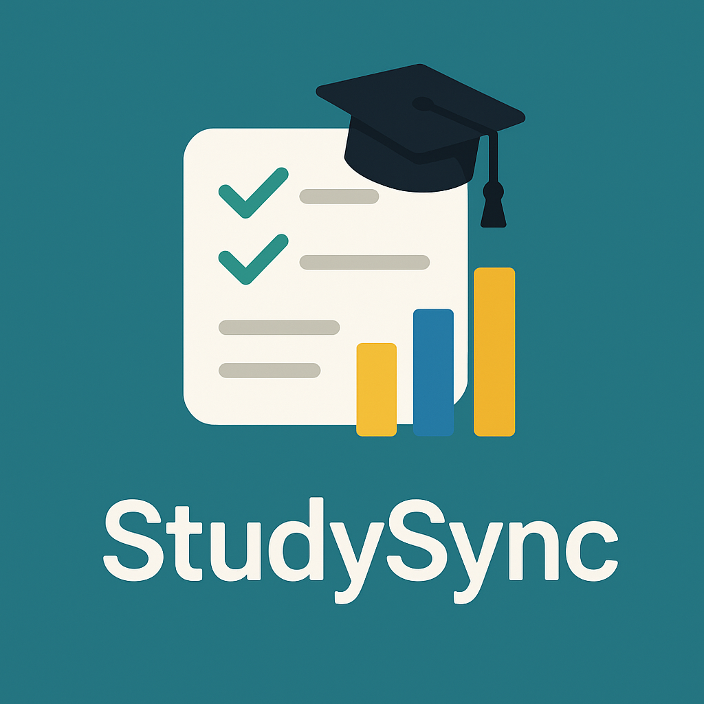

# StudySync

<div align="center">
  
  
  **A comprehensive Study Management System for academic productivity**
</div>

[](https://www.oracle.com/java/)
[](https://spring.io/projects/spring-boot)
[](https://openjfx.io/)
[](https://www.h2database.com/)
[](https://github.com/geokoko/StudySync/releases)
[](LICENSE)

## Overview

StudySync is a comprehensive Study Management System built with modern Java technologies. It combines Spring Boot's robust backend capabilities with JavaFX's rich desktop UI and H2 embedded database for reliable data persistence. The application helps students organize their academic life effectively with integrated tasks and subtasks, study tracking, and task notes.

Perfect for students who want to integrate their academic calendar with task management and study tracking! 📚✨

> **⚠️ Beta Release**: This is version 0.1.8 under active development. Features may change, and some functionality may be incomplete. Please report issues and provide feedback!

## Key Features

StudySync provides comprehensive academic management with three main modules:

## 📚 Study Planner Features, with Daily Reflections Logging
* **Study Sessions**: Track study time with built-in timer and focus level monitoring
* **Study Goals**: Set and manage daily study objectives with future date planning, each with an optional checklist of what "done" means — tick the last item and the goal is achieved
* **Future Goal Planning**: Navigate to any future date and plan goals ahead via DatePicker
* **Recurring Tasks**: Define repeating task schedules (e.g. every week on Mon/Wed/Fri)
* **Daily Reflections**: A diary tab holding every entry you have ever written — search them, write a day at a time with autosave, or read the whole diary back as a thread of dated entries
* **Markdown Diary Entries**: Reflections are markdown — headings, lists and tables (there is a button for those) — written as source and read rendered, and exportable as one `YYYY-MM-DD.md` file per day into any folder or Obsidian vault
* **Progress Tracking**: Visual progress indicators and session statistics
* **Study Analytics**: Monitor completed sessions and goal achievements
* **Off Days / Holidays**: Mark any calendar day as an off day — it shows as a holiday in the calendar and never counts towards your global scores or breaks your study streak
* **Scoring**: Points reward time studied scaled by focus, achieved goals, and finishing leaf tasks (those without subtasks) on time; the same formula drives both the per-day calendar score and your 30-day profile score

## 📋 Task Management Features
* **Task Management**: Create, edit, and delete tasks with rich attributes (title, description, category, priority, deadline, status, recurring schedule)
* **Recurring Tasks**: Give any task its own repeating schedule and optional "repeat until" date, separate from its deadline. Parents and subtasks can each be one-off or recurring; schedules are never inherited. Completing a recurring task permanently ends its future occurrences; handling one occurrence through a goal does not.
* **Subtasks**: Use **Add subtask** on a task, or choose a parent in the edit form. One level of nesting is supported. Progress counts completed subtasks, ignoring cancelled ones. Parents and subtasks follow their own dates in the planner and calendar.
* **Estimates**: Enter optional estimated hours per task. A parent shows its subtasks' total (ignoring cancelled ones) alongside its own budget, for example **Estimate: 12 h from subtasks · 40 h planned**. The two figures stay independent.
* **Completion**: Finishing the last unfinished subtask completes a one-off parent on the same date. Recurring parents show progress but never auto-complete. Marking any parent done also completes its unfinished subtasks after confirming their count and how many recurring subtasks will stop repeating. Cancelled subtasks stay cancelled. Adding or reopening unfinished work reopens a completed parent.
* **Safe deletion**: Deleting a parent also deletes all its subtasks after confirming their count. Notes, links and reschedule history are deleted; goals and study sessions remain with their task links cleared. **Delete matching tasks** applies the current filters and confirms the total and the subtasks deleted with their parents, including children outside those filters.
* **Notes and links**: Edit Markdown notes in the task form and expand **Read notes** for the rendered view. Add URLs with optional titles, reorder them with the arrows, and use **Open** for your system browser. Only `http://` and `https://` links are accepted.
* **Category Management**: Create and manage custom categories for better organization
* **Task Reminders**: Choose how many days before a deadline a task starts reminding you; it shows a countdown badge and appears under "Coming up" in the planner
* **Data Persistence**: All data stored reliably in embedded H2 database

### Upgrading from projects

Existing projects become top-level, one-off tasks on the first launch of the upgraded app.
Their text, category, priority, deadline, creation date, estimated hours and notes
are preserved. Active projects become Open tasks, On Hold becomes Postponed, and
Completed/Cancelled retain their status. Completion dates use the project's
completion date, falling back to its last update date. The old entered progress
percentage is replaced by progress derived from subtasks.

Project sessions are no longer shown or counted in scores, session counts or time.
The old project and session tables remain in the database for recovery; the app
never empties them. The import runs once and does not duplicate tasks on restart.
Before upgrading, keep a backup of the database with the app closed. Afterwards,
check the imported tasks and their notes in **Tasks**. Upgrade every machine that
uses the synced database: an older build still edits its own legacy project rows,
and those edits are not merged into the imported tasks. To recover the original
state, restore the pre-upgrade backup with all copies of the app closed.

## Google Calendar Integration (planned and **not** implemented as of now)
* **OAuth 2.0 Authentication**: Secure Google account login
* **Today's Events**: View all Google Calendar events for the current day
* **Real-time Sync**: Refresh calendar events with one click
* **Seamless Integration**: Calendar events displayed alongside study tasks

## ☁️ Google Drive Sync
* **Google Sign-in**: Connect your personal Google account directly from the Profile window
* **Drive Storage**: The embedded H2 database is uploaded to a private `StudySync` folder inside your Drive
* **Multi-device ready**: Pull the Drive copy with `Download from Drive` and it is applied on the next launch; when signed in, the app offers to upload the local database on close
* **Manual Sync**: Trigger `Sync to Drive now` anytime you want an extra backup mid-session
* **Purely local**: No StudySync backend—OAuth tokens and the H2 file never leave your machine + Google Drive

## Installation & Running the Application

### Quick Install (Linux)

Both options run the same installer — the difference is whether you start from a pre-built release or compile from source.

**Pre-built release** (no Gradle required, just Java 21):
```bash
curl -LO https://github.com/geokoko/StudySync/releases/latest/download/studysync-linux.tar.gz
curl -LO https://github.com/geokoko/StudySync/releases/latest/download/studysync-linux.tar.gz.sha256
sha256sum -c studysync-linux.tar.gz.sha256
tar -xzf studysync-linux.tar.gz
cd studysync-*-linux
./install.sh
```

**Build from source** (requires JDK 21; the Gradle wrapper is included):

Install JDK 21 and select it in your terminal before building. Replace `/path/to/jdk-21` below with your JDK 21 installation directory (the directory containing `bin/java` and `bin/javac`).

```bash
git clone https://github.com/geokoko/StudySync.git
cd StudySync
export JAVA_HOME="/path/to/jdk-21"
export PATH="$JAVA_HOME/bin:$PATH"
java -version   # Should report Java 21
javac -version  # Should report javac 21
./scripts/install.sh --build
```

No separate Gradle installation is needed. These Java settings apply to the current terminal session.

> **Build fails with `Unsupported class file major version 69`?** Class file major version 69 corresponds to Java 25, which cannot run the bundled Gradle 8.12.1. Select JDK 21 using both `JAVA_HOME` and `PATH` above, then rerun the installer. The installer's “Java 21 or later” check also accepts Java versions that cannot run this Gradle version. The project's Java 21 toolchain controls compilation; it does not select the Java version that starts Gradle. See the [Gradle Java compatibility matrix](https://docs.gradle.org/current/userguide/compatibility.html).

After installation:
- **Launch from app menu**: Search "StudySync" in your application launcher (KDE, GNOME, etc.)
- **Launch from terminal**: Run `studysync`

To uninstall: `~/.local/share/studysync/bin/uninstall.sh`

> **Installing a beta:** `releases/latest` resolves to the newest *stable* release, so the commands above skip pre-releases. To install a specific version, use its tag:
> ```bash
> curl -LO https://github.com/geokoko/StudySync/releases/download/v0.1.6-beta/studysync-linux.tar.gz
> curl -LO https://github.com/geokoko/StudySync/releases/download/v0.1.6-beta/studysync-linux.tar.gz.sha256
> ```
>
> Tip: `studysync-linux.tar.gz` is a stable alias attached to every release. Versioned files (`studysync-<version>-linux.tar.gz`) are also attached.

---

### Running with Gradle (Development)

Use JDK 21 and set `JAVA_HOME` and `PATH` as shown in the source installation instructions above.

1. Clone the Repository
    ``` bash
    git clone https://github.com/geokoko/StudySync.git
    cd StudySync
    ```
2. Configure the application
    ```bash
    cd ./src/main/resources
    cp application.yml.template application.yml
    # Edit application.yml if needed (optional for basic usage)
    ```

3. Run the Application
    * Use the Gradle wrapper (recommended):
        ``` bash
        ./gradlew run   # (Linux/macOS)
        gradlew run     # (Windows)
        ```

    * Use Gradle if you have it installed:
        Use Gradle 8.12.1 with JDK 21 to match the wrapper, then run:
        ``` bash
        gradle build
        gradle run
        ```
        **Note**: Prefer the included wrapper to use the project's configured Gradle version.

    Gradle will:
    * Automatically download all dependencies (JavaFX, H2 Database, Spring Boot, etc.)
    * Set up the module path correctly for JavaFX
    * Initialize the H2 embedded database
    * Launch the application (com.studysync.StudySyncApplication)

### Additional Run Options

* **Fast startup** (skip some initialization):
    ```bash
    ./scripts/start-fast.sh
    ```

* **Build release package** (for distribution):
    ```bash
    ./scripts/build-release.sh
    # Creates build/release/studysync-VERSION-linux.tar.gz
    ```

## Google Drive Sync Setup (Optional)

1. **Create Google API credentials**
   * Visit [Google Cloud Console](https://console.cloud.google.com/)
   * Enable the **Google Drive API** for your project
   * Create OAuth client credentials of type **Desktop application** and note the client ID/secret
2. **Provide the credentials to StudySync**
   * Copy the template file and fill in the values:
     ```bash
     cp config/google/drive.properties.template config/google/drive.properties
     # edit config/google/drive.properties with your client id/secret
     ```
   * You can override the Drive folder name, redirect port, or where credentials are cached as needed
3. **Run StudySync and connect your Google account**
   * Launch the app, open the **Profile → Google Drive Sync** panel, and click **Sign in with Google**
   * Your browser will handle OAuth locally; tokens are stored in `~/.studysync/google`
4. **Understand the sync flow**
   * Downloading is **manual**: press `Download from Drive`, then restart. The copy is verified against its checksum and applied before H2 opens, and your previous database is kept under `data/backups/`
   * When signed in, closing offers `Push to Drive & Exit`, `Save Locally & Exit`, `Exit without Saving`, or `Cancel`. You can also upload manually with `Sync to Drive now`. Without a signed-in account, closing saves locally
   * StudySync never merges the two sides. If both have changed, pick one — `Download from Drive` replaces local, `Sync to Drive now` replaces remote

### Setting up a second machine

`drive.properties` holds your client ID/secret and is **not** part of the release tarball, which ships only the template. Copy it across yourself:

```bash
scp ~/.local/share/studysync/config/google/drive.properties \
    other-machine:~/.local/share/studysync/config/google/
```

Then, on the new machine: launch StudySync → **Profile → Sign in with Google** → **Download from Drive** → **restart**. Until you download and restart you are looking at an empty database — nothing is fetched automatically. OAuth tokens under `~/.studysync/google` are per-machine; sign in again rather than copying them.

> The actual database file lives inside `My Drive/StudySync/studysync.mv.db`. No remote StudySync server is involved—the desktop app talks to Google APIs directly.

## Architecture

StudySync uses the **Active Record pattern** with Spring Boot for a clean, maintainable architecture.
See [ARCHITECTURE.md](ARCHITECTURE.md) for detailed architectural information and code examples.

## Data Storage

* **Database**: H2 embedded database (`data/studysync.mv.db`)
* **Schema Migrations**: `schema.sql` re-runs on every startup, so statements are additive (`ALTER TABLE ... ADD COLUMN IF NOT EXISTS`) or recompute derived data. The few genuinely one-shot migrations are guarded by a `schema_migrations` marker table so they cannot re-fire
* **Cloud Backup (optional)**: When Drive sync is enabled, the same file is mirrored to `My Drive/StudySync/studysync.mv.db`
* **Logs**: Application logs stored in `logs/` directory
* **Configuration**: YAML configuration files in `src/main/resources/`
* **Security**: Encrypted credentials stored locally
